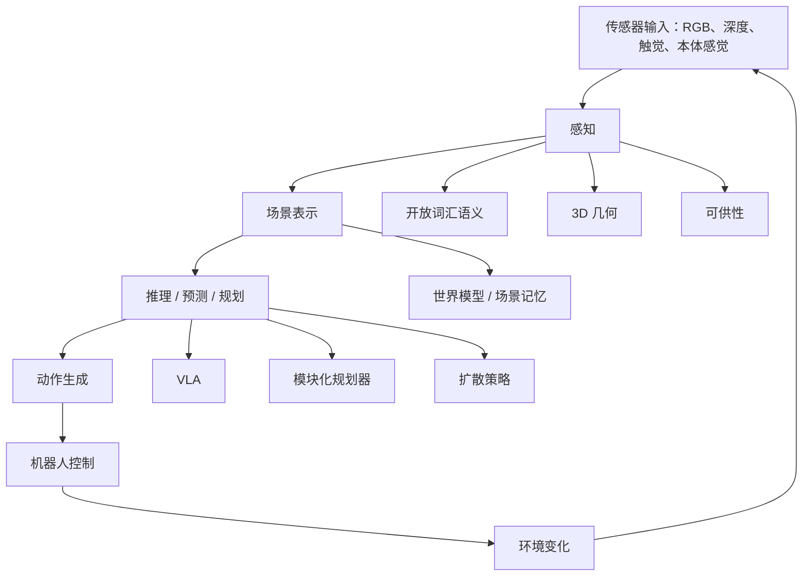

# 概述与路线图

> **英文原文：** [Overview Roadmap](../../robotics-cv-knowledge-base/06_vla_and_embodied_foundation_models/00_overview_roadmap.md)
> **最后更新：** 2026-10-18
> **难度级别：** 高级
> **对机器人的意义：** 具身基础模型将视觉表示学习置于“感知—记忆—推理—动作”闭环之中，其中的误差会改变下一时刻的观测，并可能导致物理层面的失效。评估概述与路线图，必须看它对物理决策的影响，而不能仅看被动识别的准确率。
> **相关章节：** [VLA 模型架构](01_vla_model_architectures.md)、[知识库索引](../INDEX.md)

## 概述

视觉-语言-动作模型（VLA）将视觉观测、语言与机器人状态映射为动作，通常做法是适配一个预训练的视觉语言模型（VLM）并添加动作解码器。各类架构的区别在于动作词元化、连续回归、扩散或流匹配动作头、动作分块、记忆机制以及控制层级。核心约束在于多时间尺度运行：语义推理可以以数赫兹的频率运行，而稳定的接触与全身控制可能需要数十至数百赫兹。世界模型则学习具有预测性的状态转移，可用于想象或规划；混合系统正日益将两者结合起来。

机器人优先的视角关心的不是模型能否描述一幅图像，而是它能否维持进行干预所需的正确状态。相关状态包括位姿、自由空间、铰接结构、支撑关系、容纳关系、材质、接触、不确定性，以及在动作作用下的预期变化。由于动作会改变观测，感知与控制构成了一个耦合的动力学系统。这使得标定、时间一致性、恢复以及分布外检测成为首要的研究关切。

当代技术栈由四个相互耦合的层次构成。感知将传感器数据流转换为对物体、几何、运动、接触及不确定性的估计。场景表示与记忆在遮挡和动作过程中持续维护这些估计。推理或预测负责选择子目标、估计后果，并判断何时需要获取更多信息。动作生成与控制产生特定于具身形态的轨迹，并以与硬件相匹配的频率闭合控制回路。VLA 将若干层压缩进一个经过训练的单一系统；模块化规划器保持接口显式；世界模型预测状态转移；扩散策略或流策略对局部动作分布进行建模。

与经典机器人感知相比，重要的变化并不在于检测消失了。检测、分割、位姿估计、跟踪、建图与标定仍然存在，或以显式方式进行，或隐含于学习得到的特征之中。真正改变的是训练目标与接口：感知越来越多地与语言和动作联合优化，而表示可能是隐变量，而非人工标注的结果。这能够保留手工设计的接口所遗漏的任务相关线索，但也使几何、不确定性以及失败原因更难以检查。

一种在近期看来较为可行的架构是分层且异步的。大型多模态模型以低频率执行开放词汇理解与任务分解；以物体为中心的 3D 记忆维护持久状态；预测模型评估候选状态转移；紧凑的反应式策略则在安全约束下执行动作分块。Figure 的 Helix 将时间尺度的划分显式化，而 pi0.5 则将高层文本子任务预测与连续的流匹配动作专家相结合。这些只是设计上的取舍点，并不能证明分层问题已经解决：持久记忆与恢复能力目前都仍缺乏充分评估。

## 核心技术思想

1. **任务条件下的充分性。** 表示应保留控制器所需的变量，同时排除干扰性变化。对于避碰、插装、叠衣服以及语言条件下的搜索，所需的充分状态各不相同。
2. **几何与语义相结合。** 度量结构支持可达性分析与碰撞检测；语义则识别与任务相关的实体及其可能的功能。在开放世界场景中，单靠其中任何一方都不够。
3. **时间与因果上的落地。** 跟踪与记忆能够区分持久状态与瞬时外观。动作条件化的观测会揭示铰接结构、质量、摩擦、柔顺性以及隐藏的约束。
4. **不确定性与拒绝执行。** 机器人需要经过校准的置信度、异常检测以及信息获取动作。一个看似合理却错误的预测，比明确请求换一个视角或寻求人类帮助更加危险。
5. **闭环评估。** 数据集指标可以隔离各个组件，但部署需要衡量任务成功率、干预率、恢复能力、延迟，以及跨越数小时、不同场景和不同硬件条件下的性能。

在架构上，模块化流水线暴露中间状态并允许几何验证，而端到端策略直接优化最终行为，并能利用标注所遗漏的线索。混合系统使用预训练的视觉-语言特征提供语义，使用显式地图或物体记忆维持持久性，使用学习得到的动作生成器进行局部控制，并在执行环节外围施加经典的安全约束或运动约束。

## 为什么这在机器人学中重要

在机器人操作中，毫米级的位姿、深度或接触误差会直接转化为抓取失败和碰撞。导航则会在长轨迹上不断累积定位漂移和过时的语义记忆。人机交互进一步引入了不确定的意图与安全裕度。真实机器人还要面对反光与透明材料、自遮挡、光照变化、传感器掉线、执行器延迟以及训练中从未出现过的物体。

因此，一个可信的结果应当说明具身形态、传感器、控制频率、推理硬件、环境划分、试验次数、重置策略、干预策略以及失效分类体系。泛化声明应指明被留出的轴：物体、布局、任务、指令、具身形态、动力学或时间。将这些轴汇总成单一的成功率数字，会掩盖系统究竟在哪些方面实现了迁移。

## 形式化问题定义

VLA 策略对以多模态历史与目标为条件的动作序列进行建模：
\[
\pi_\theta(a_{t:t+H-1}\mid o_{t-K:t},q_{t-K:t},\ell,e),
\]
其中 \(q\) 为本体感觉，\(\ell\) 为语言，\(e\) 标识具身形态（本体）或动作约定。
时域 \(H\)、观测窗口 \(K\)、控制频率与执行策略都是模型定义的一部分。
单步策略、开环动作分块与滚动时域（receding-horizon）扩散策略，即使在相同的轨迹上训练，也会诱导出不同的闭环系统。

对于 **概述与路线图**，论文级别的问题规范应明确给出随机变量、坐标系、预测时域以及决策接口。它还应陈述那些常被隐藏的假设：场景是静态还是动态的，传感器是经过标定的还是存在漂移，物体是已知的还是开放集合的，交互是刚性的还是可变形的，以及是否允许测试时自适应或人工纠正。这些假设比模型名称更精确地界定了真正要解决的问题。

### 按信息流划分的分类体系

最具信息量的分类方式，是依据信息在何处被压缩来区分各类系统。在单体式（monolithic）策略中，图像、语言、本体感觉与动作词元共享同一主干网络，唯一对外可见的状态就是动作本身。在分层式策略中，一个慢速模型预测子目标、潜在规划或语义嵌入，再由快速控制器加以消费。在模块化栈中，显式的物体、地图、轨迹或约束在组件边界之间传递。在基于模型的智能体中，候选动作通过预测的未来状态进行评估。这些选择不仅决定了精度，还决定了可调试性、延迟、数据复用程度，以及安全约束可以插入的位置。

因此，这份路线图应沿四个维度来阅读。**表示**：状态是基于词元的、以物体为中心的、度量 3D 的，还是无结构的隐变量？**动作生成**：输出是离散词元、连续回归、扩散采样、流轨迹，还是供底层控制器使用的参考量？**时间组织**：系统是反应式的、分块的、循环的、记忆增强的，还是显式分层的？**学习信号**：网络数据、视频、示范、仿真、自主执行轨迹与偏好分别如何发挥作用？一篇可信的论文应当明确其在全部四个维度上的定位，并对其所声称的进步来源进行消融。

### 研究里程碑

一条有用的进阶路径，远比一系列规模越来越大的演示更难达成。第一，在物体与视角变化下建立可重复的单技能控制。第二，在保持运动技能固定的前提下测试组合式指令。第三，引入持久性的状态变化，并要求系统能从失败的子目标中恢复。第四，在声明适配预算的前提下实现跨场景与跨具身迁移。第五，评估无人值守运行以及经过校准的拒绝执行（abstention）。每个阶段都应保留前一阶段的对照条件，否则表面上的长时程进步可能源自更容易的重置、更宽松的成功判据，或隐藏的人工协助。

## 符合 CVPR / 机器人学研究标准的实验设计

### 假设与基线

应从一个可证伪的假设出发，而不是“我们的模型提升了性能”。一个有力的假设应指明具体机制：时间记忆应当恰好在遮挡之后提升性能；度量 3D 状态应当改善视角迁移；触觉输入应当在首次接触之后发挥作用；异构预训练应当降低目标域的样本复杂度。所选基线应能隔离这一机制：一个去掉该组件但容量匹配的模型、一个经典或模块化的替代方案，以及一个通过相同观测与动作接口进行评估的当前强系统。

应尽可能匹配数据、优化步数、数据增强、动作时域和部署频率。仅仅匹配参数量并不是充分的对照，因为冻结的预训练模块、上下文长度、图像分辨率和采样步数都会改变有效计算量。应报告训练 FLOPs 或加速器小时数，以及实测的推理延迟。当无法做到精确匹配时，应披露这种不对称，并给出资源-性能曲线，而不是单一数据点。

### 数据划分、数据泄漏与泛化

实验单元应当是希望泛化的那个因素：物体实例、物理场景、建筑、操作员、任务模板、机器人或采集日期。随机划分相邻帧会泄漏外观与状态信息。随机划分来自同一次重置的示范可能泄漏轨迹。即使物体实例是新的，语言模板也可能泄漏任务身份。应在训练之前构建分组划分，并公开分组标识符。

应将分布内性能与每个留出轴（held-out axis）上的性能以及这些轴组合下的性能分别报告。“未见过”必须说明是在什么意义上未见过。已知类别和已知位姿下的新物体不同于未知类别；未见过的指令改写也不同于一项新的物理技能。对于预训练模型，应审查其与公开数据集之间可能存在的重叠；当预训练数据来源不明时，应避免宣称严格的零样本新颖性。

### 统计与报告

闭环试验的结果是伯努利或有序变量，并伴随大量环境变异。应报告分子与分母，而不只是百分比。应为成功率给出置信区间（例如 Wilson 区间），按场景或任务分层，并在试验嵌套于物体或环境之内时使用层次自助法（hierarchical bootstrap）。应运行足够多的独立随机种子以暴露优化方差，并进行足够多的物理试验以暴露部署方差。不要把同一回合（episode）中的数千帧视频当作独立样本。

平均成功率应同时附上最差组性能、完成时间、干预次数、安全违规、恢复成功率以及失效分类体系。对于成功判定模糊的任务，应预先注册成功标准；当需要人工判断时，应在不知晓所用方法的情况下（盲评）对视频打分。在发布的日志中应保留失败的运行和超时情况。

## 诊断性消融与失效分析

消融实验应以能够检验所声称因果机制的方式移除信息或容量。有用的干预包括：移除时间上下文、打乱语言、屏蔽本体感觉、扰动标定、延迟某一模态、用真值替换预测的几何，以及用预言机（oracle）替换规划器或控制器。预言机研究可以定位瓶颈：真值位姿检验感知差距，真值子目标检验推理差距，而在经过验证的控制器下回放则检验动作差距。

压力测试应改变光照、杂乱程度、遮挡、相机位姿、干扰物、反光或透明材料、执行器延迟以及场景布置。对于每一次失效，应记录最早可观测的先兆，以及系统的置信度是否在物理错误发生之前已经发生变化。一个有用的分类体系应区分感知失效、状态估计失效、语义落地（grounding）失效、规划失效、控制失效以及无效的评估假设。“策略失败了”不能算作分析。

## 可复现性清单

- 公开精确的训练、验证和测试回合标识符。
- 记录机器人型号、末端执行器、传感器、标定流程与控制接口。
- 说明观测频率、策略频率、动作时域、实际执行的分块长度以及延迟分布。
- 发布动作归一化方式、坐标系约定、预处理流程与成功判定条件。
- 报告模型初始化、冻结模块、优化器、学习率调度、数据增强、随机种子与计算资源。
- 保留每次试验的结果、干预日志、重置策略、排除项以及有代表性的失效案例。
- 区分仿真、回放、人类遥操作、自主执行以及经过事后挑选的视频。
- 记录许可证、隐私约束、安全限制以及任何无法获取的专有训练数据。

## 博士论文级研究问题

1. 对于概述与路线图，哪些隐变量是必要且充分的？如何通过干预而不仅仅依靠探针（probe）来检验其充分性？
2. 在哪些分布偏移下，所提出的表示会平稳退化、出现校准失准，或产生自信却不安全的动作？
3. 在数据、计算量、控制频率以及特权几何信息都与模块化基线相匹配之后，端到端学习究竟带来了哪些收益？
4. 主动感知或接触能否比增大模型规模或增加示范数量更高效地降低不确定性？
5. 性能如何随任务多样性、环境多样性、具身形态多样性和轨迹数量的独立变化而扩展？
6. 哪些失效能够被足够早地检测出来，从而实现拒绝执行、重新规划或请求人类协助？这些安全措施的代价又是什么？

## 近期进展（2025 年中至 2026 年 10 月）

截至 2026 年 10 月，整个技术栈由三项结构性转变所界定。

1. **“推理器 + 执行器”的层级结构成为默认范式。** Google DeepMind 将 Gemini Robotics-ER（具身推理、规划、工具调用、进度跟踪）与 Gemini Robotics VLA（2025 年 9 月发布 1.5，2026 年 7 月发布 2）配对使用。NVIDIA 的 GR00T N1.6 以 Cosmos Reason 作为其“System 2”。Figure 的 Helix 02（2026 年 2 月）新增了第三层：S2 负责语义推理，S1 以 200 Hz 进行视觉运动控制，新增的 S0 则是以 1 kHz 运行的学习型全身控制器。
2. **控制范围从机械臂和上半身扩展到全身。** 例子包括 Helix 02、运行在 Apptronik Apollo 2 上的 Gemini Robotics 2、Boston Dynamics/TRI 在 Atlas 上部署的单一大型行为模型（Large Behavior Model，2025 年 8 月），以及 GR00T N1.6 在 Unitree G1 上的移动操作（loco-manipulation）。导航、平衡与操作如今是联合学习的，而不再由彼此独立的技术栈组合而成。
3. **“世界动作模型”（world action model）模糊了 VLA 与世界模型之间的界限。** NVIDIA 的 DreamZero（2026 年 2 月，GR00T N2 预览版的基础）与 Cosmos 3（2026 年 6 月）联合生成未来视频与动作。1X 的世界模型（2026 年 1 月）先想象出一段视频推演，再通过逆动力学恢复动作。

另外两项趋势：

- **在模仿学习预训练之上进行强化学习（RL）已成为主流。** Physical Intelligence 的 π\*0.6 结合 RECAP（2025 年 11 月）是被引用最多的工业界案例。
- **评估正在转向分布式竞技场与学习型仿真器。** 例子包括 RoboArena、RoboChallenge，以及基于 Veo 和 Ctrl-World 的策略评估器。

本路线图中的里程碑保持不变。持久记忆、经过校准的拒绝执行（abstention）以及无人值守的数小时连续运行，仍是证据最薄弱的阶段。

## 关键系统/方法/论文

| 名称 | 年份 | 类型 | 意义 |
|------|------|------|------|
| RT-1 | 2022 | 机器人 Transformer | 扩展了多任务真实机器人行为 |
| RT-2 | 2023 | VLA | 将动作表示为类语言词元 |
| OpenVLA | 2024 | 开源 VLA | 发布了可复现的 7B 参数 VLA |
| Octo | 2024 | 开源策略 | 在多个机器人数据集上训练的通用 Transformer |
| pi0 | 2024 | 流匹配 VLA | 采用流匹配动作专家 |
| Helix | 2025 | 人形机器人 VLA | 将 7-9 Hz 语义推理与 200 Hz 控制解耦 |
| Gemini Robotics 1.5 / 2 | 2025 | 推理器 + VLA | 将具身推理规划器与 VLA 配对；第 2 版加入人形机器人全身控制 |
| pi*0.6 (RECAP) | 2025 | 经强化学习精调的 VLA | 基于经验与人工干预、以优势为条件的强化学习 |
| GR00T N1.6 / N1.7 | 2025 | 人形机器人 VLA | 以 Cosmos Reason 为规划器的开放人形机器人策略 |
| DreamZero | 2026 | 世界动作模型 | 联合预测视频与动作；是 GR00T N2 预览版的基础 |
| pi0.7 | 2026 | 可引导的 VLA | 提示可混合子任务文本、元数据与子目标图像 |

这些系统不应被解读为一张线性的排行榜。它们对标定、数据获取、动作空间、环境结构以及评估方式做出了不同的假设。最有用的比较方式是追问：在目标机器人的部署场景中，哪些假设依然成立。

## 基准/数据集/评估

| 基准或数据集 | 任务 | 指标 | 意义 |
|--------------|------|------|------|
| Open X-Embodiment | 跨具身策略学习 | 各任务成功率 | 汇聚异构机器人经验 |
| LIBERO | 终身学习操作 | 任务成功率 | 测试迁移与任务干扰 |
| CALVIN | 语言条件长时程任务 | 序列完成度 | 衡量技能的链式执行 |

离线指标对于诊断是必要的，但对机器人学而言并不充分。还应加入闭环成功率、完成时间、碰撞或损坏率、人工干预次数、恢复成功率、标定误差、最差组性能以及置信度校准。应报告跨试验、跨环境的不确定性，而不是挑选演示视频。

## 优势、局限与失效模式

| 维度 | 优势 | 局限 |
|------|------|------|
| 学习得到的表示 | 能够迁移语义，并利用大规模异构数据集 | 可能编码数据集中的捷径，并丧失度量一致性 |
| 显式几何 | 可解释、可测量，且与规划兼容 | 在深度缺失、动态变化、可变形性和标定误差下表现脆弱 |
| 端到端策略 | 直接优化行为，减少人工设计的接口 | 难以审计；失效会将感知、推理与控制耦合在一起 |
| 模块化系统 | 各组件可以被单独测试、替换和进行安全检查 | 接口误差与和任务无关的优化目标可能限制性能上限 |
| 仿真 | 可扩展地生成标注、干预与罕见事件 | 外观、接触、动力学与行为上的差距可能相互叠加 |
| 开放词汇模型 | 能识别长尾概念并理解灵活的指令 | 语义相似性并不能确立位姿、可达性或可供性 |

常见失效包括：遮挡引起的身份切换、参考坐标系混淆、物体移动后记忆过时、自信地幻觉出不存在的物体、透明表面上的深度失效、接触过程中的时间滞后，以及只能在狭窄的重置分布下才能成功的策略。由于数据集过度代表成功的示范，恢复行为往往训练不足。

## 开放问题

- 构建持久的 3D/4D 记忆，使其能够在机器人与人类干预之后更新，且不发生灾难性漂移。
- 将语义、几何与动作的不确定性校准为一个统一的、与决策相关的量。
- 学习能够跨物体实例、材质与具身形态迁移的可供性与接触动力学。
- 以透明的重置、干预、失效记录和置信区间来评估长时域自主性。
- 将网络规模的先验与机器人数据相结合，同时不引入视觉捷径或不安全的常识假设。
- 在不遗忘安全约束的前提下，在线适应传感器、标定、环境与硬件的变化。
- 为可变形物体、透明物体、铰接机构以及多智能体交互开发合适的表示。

## 与相邻主题的联系

本主题位于感知与控制之间。它依赖 `02_robot_perception_foundations` 中的基础知识，从 `04_3d_and_spatial_understanding` 获得空间结构，并通过 `05_multimodal_perception` 将语义与接触联系起来。其最终价值在 `08_manipulation_navigation_and_control` 中得到检验；数据与可复现性方面的约束则在 `07_data_simulation_and_training` 中讨论。

## 延伸阅读

- [Open X-Embodiment / RT-X 项目主页](https://robotics-transformer-x.github.io/)
- [OpenVLA 项目主页](https://openvla.github.io/)
- [Octo 项目主页](https://octo-models.github.io/)
- [Physical Intelligence pi0 博客](https://www.pi.website/blog/pi0)
- [Physical Intelligence pi0.5 博客](https://www.pi.website/blog/pi05)
- [Figure Helix（Figure AI 官方发布）](https://www.figure.ai/news/helix)
- [Gemini Robotics（Google DeepMind 博客）](https://deepmind.google/blog/gemini-robotics-brings-ai-into-the-physical-world/)
- [NVIDIA GR00T 开发者页面](https://developer.nvidia.com/isaac/gr00t)
- [Physical Intelligence pi*0.6（RECAP）论文](https://arxiv.org/abs/2511.14759)
- [Gemini Robotics 1.5（Google DeepMind 博客）](https://deepmind.google/blog/gemini-robotics-15-brings-ai-agents-into-the-physical-world/)
- [V-JEPA 2 论文](https://arxiv.org/abs/2506.09985)
- [RoboArena 论文](https://arxiv.org/abs/2506.18123)
- [NVIDIA Cosmos 3 发布](https://nvidianews.nvidia.com/news/nvidia-launches-cosmos-3-the-open-frontier-foundation-model-for-physical-ai)
- [Robotics: Science and Systems 会议论文集](https://www.roboticsproceedings.org/)
- [CoRL 会议论文集](https://proceedings.mlr.press/)
